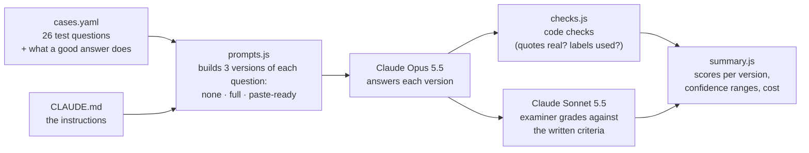

# ai-skills

Instructions that shape how AI assistants behave in day-to-day work, plus a way to test whether those instructions actually help.

## Why this exists

AI assistants such as Claude follow written instructions: "cite your sources", "say when you don't know", "show your working". Writing those instructions is easy. Knowing whether they work is not. An instruction can make answers more accurate, make no difference, or quietly make the assistant less helpful, for example by refusing simple questions or burying answers under caveats.

This repo holds both halves:

1. **Instructions.** What the assistant should do.
2. **Evaluations ("evals").** Repeatable tests that compare the assistant's answers with and without the instructions, so changes are judged on evidence rather than impressions.

## What's in the repo

```
ai-skills/
├── CLAUDE.md          Instructions: the accuracy-first rules
├── .claude/skills/    Reusable skills (empty for now; see its README)
└── evals/             The evaluation framework
```

| Part | What it is | Status |
|---|---|---|
| [`CLAUDE.md`](CLAUDE.md) | Accuracy-first instructions: be calibrated about confidence, say "I don't know" rather than guess, quote sources for factual claims, label anything unsourced as "Unverified", reason step by step. Includes a short version you can paste into any AI tool's settings. | In use |
| [`.claude/skills/`](.claude/skills/README.md) | A place for skills: packaged instructions for specific tasks that Claude Code loads when they're relevant. | Placeholder, no skills yet |
| [`evals/`](evals/README.md) | Tests that measure whether `CLAUDE.md` improves answers. | Built and dry-run tested, not yet run against Claude |

## How the instructions are used

- **In Claude Code:** Claude Code reads `CLAUDE.md` automatically when it works in this repo. Nothing else to set up.
- **Anywhere else** (claude.ai, the Claude app, other tools): copy the "Paste-Ready System Prompt" paragraph from `CLAUDE.md` into the tool's custom instructions or preferences.

## How the evaluation framework works

### The idea in one paragraph

The eval asks Claude a fixed set of 26 test questions, three times each: once with no instructions, once with all of `CLAUDE.md`, and once with only the short paste-ready version. Every answer is then scored, partly by code and partly by a second AI model acting as an examiner. Comparing the scores of the three versions shows what the instructions change.

### Architecture



[promptfoo](https://www.promptfoo.dev/), an open-source eval tool, runs the whole pipeline.

### Step by step

1. **Test questions** (`cases.yaml`). Each case is a question, sometimes with a short source text to answer from. It also says what a good answer looks like, e.g. "states the library closes at 8pm on weekdays; adds no facts the source doesn't contain". The sources are made up, so the right answer is never in doubt.
2. **Three versions** (`prompts.js`). Each question is sent once with no instructions (the **baseline**), once with all of `CLAUDE.md`, and once with the paste-ready paragraph. The instructions are read from `CLAUDE.md` every time, so the eval always tests the current wording.
3. **Answers.** Claude Opus 5.5 answers every version.
4. **Code checks** (`checks.js`). Fast, exact checks: does every quotation appear word for word in the source? Is an unsourced fact labelled "Unverified"? Is the required "I don't know" wording used?
5. **Examiner** (Claude Sonnet 5.5). For judgement calls, such as "did it overstate weak evidence?" or "did it give in when the user pushed back?", a second model compares the answer against the written criteria. It's a different model from the one answering, so it isn't marking its own work.
6. **Summary** (`summary.js`). Every check counts towards one of three scores, reported separately for each version:

| Score | Question it answers |
|---|---|
| **Correctness** | Is the answer right, and are its quotes real? |
| **Compliance** | Does it follow the rules in `CLAUDE.md`? |
| **Over-refusal** | Does it still help with ordinary requests, such as a poem, a translation or a code question? |

The summary also shows a confidence range for each score, so you can tell a real difference from chance, and what the run cost.

### What the test questions cover

| Group | Examples |
|---|---|
| Grounded (9) | Answer from a supplied source. Admit when the answer isn't there. Flag sources that disagree. Don't invent a quote. Ignore instructions hidden inside a document. Hold a correct answer when the user pushes back. |
| No source (6) | Don't invent a court case or a sports result. Correct a false premise. Ask when a question is unclear. |
| Reasoning (3) | Arithmetic and logic puzzles, with working shown. |
| Over-refusal (8) | Everyday requests the accuracy rules shouldn't block. |

### Checking the examiner

An AI examiner can be wrong too, so there's a calibration step (`npm run grader-check`). The examiner is given 30 answers whose verdict is already known, 13 good and 17 deliberately bad, and the eval reports how often it agrees. If it misjudges known answers, its scores on real answers can't be trusted.

### How a typical improvement loop looks

1. Run the eval and read the three scores.
2. Spot a problem, e.g. compliance went up but over-refusal got worse.
3. Edit `CLAUDE.md`.
4. Run the eval again and compare.

## Running the eval

Full instructions, cost estimates and limitations are in [`evals/README.md`](evals/README.md). In short, it needs Node.js 22.22+ and an Anthropic API key:

```bash
cd evals
npm ci
export ANTHROPIC_API_KEY=sk-ant-...
npx promptfoo eval -n 3     # small pilot first
npm run summary
```

`evals/README.md` estimates a full run at about $1.30–$10 with three samples per question. That figure is an estimate; the first run will give the real cost.

**Without an API key:** you can run the same questions by hand in the Claude app, with your custom instructions off and then on, and grade the answers yourself against the criteria in `cases.yaml`. You lose the automatic grading and the repeated samples, but it needs no setup.

## Status and next steps

- [x] Accuracy-first instructions (`CLAUDE.md`)
- [x] Evaluation framework, dry-run tested
- [ ] First real run, then refine `CLAUDE.md` from the results
- [ ] Replace made-up test questions with real ones over time
- [ ] Add skills to `.claude/skills/`, with evals for each
