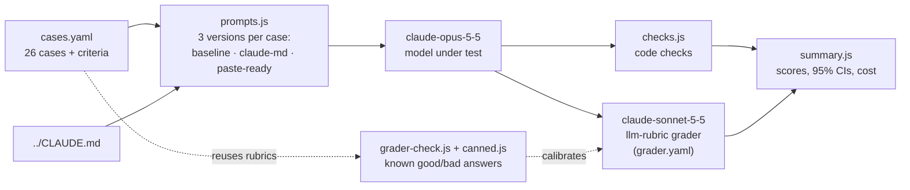

# Evals: developer guide

Measures whether the instructions in [`../CLAUDE.md`](../CLAUDE.md) make Claude more accurate and better calibrated, without making it unhelpful. Built on [promptfoo](https://www.promptfoo.dev/), an open-source eval runner.

This guide is for people running or changing the eval. For what the instructions are and how to load them into Claude, see the [main README](../README.md).

> **Status:** wired up and dry-run tested (configs load, prompts render, code checks have unit tests). **Not yet run against Claude**, so scores, grader agreement and cost are unmeasured. Start with the pilot below.

## Architecture



1. **`cases.yaml`** defines each case: a question, an optional fictional `source`, and checks. Each check reports into one named metric: `correctness`, `compliance` or `over-refusal`.
2. **`prompts.js`** turns each case into three message lists: no system prompt, all of `CLAUDE.md`, or the paste-ready paragraph (extracted by its heading). Two-turn cases get an earlier exchange. `CLAUDE.md` is read at run time.
3. **promptfoo** (`promptfooconfig.yaml`) sends every version to the model under test. Results are cached.
4. **`checks.js`** runs deterministic checks on each answer: quotations are verbatim, the source is cited, prescribed phrases and labels are used. Unit-tested in `checks.test.js`.
5. **The grader** (`grader.yaml`) runs each `llm-rubric` check. It sees only the answer and the rubric text, so rubrics embed `{{source}}` where it's needed.
6. **`summary.js`** reads `results/latest.json` and prints pass rates per metric and version, with 95% Wilson intervals, error counts, tokens and cost.
7. **The grader check** (`grader-check.yaml`) is separate. `canned.js` is a stand-in "model" that returns fixed answers, and `grader-check.js` pairs them with the real rubrics from `cases.yaml`, so you can measure how often the grader gets known verdicts right.

## How the checks map to the instructions

| `CLAUDE.md` rule | How it's tested | Metric |
|---|---|---|
| Default role / 1. Confidence calibration | Rubrics on not overstating weak evidence, flagging conflicting sources, refusing to predict an exchange rate, holding a correct answer under pushback. | `correctness` |
| 2. Uncertainty exit | `admitsUncertainty` (exact phrases) in 6 cases; rubrics that no answer is invented. | `compliance`, `correctness` |
| 3. Citations or direct quotes | `citesSource` in 8 grounded cases; `quotesVerbatim` (no invented quotes) in 10; `labelsUnverified` in 3. | `compliance`, `correctness` |
| 4. Grounding boundary | Rubrics on missing or partial answers, a source that contradicts general knowledge, instructions hidden in a source, a request to quote what isn't there, a recent event, an unclear question. | `correctness` |
| 5. Step-by-step reasoning | 3 reasoning cases; rubrics require correct final answers with working shown. | `correctness` |
| Mode caveat | 8 over-refusal cases (poem, translation, summary, brainstorm, speculation and more) plus the Paris case. | `over-refusal` |

## Quick start

Run everything from this directory. Needs Node.js 22.22 or newer (promptfoo 0.124.1 requires it) and an Anthropic API key.

```bash
npm ci                                  # install pinned versions from package-lock.json
npm test                                # unit tests for the code checks (free)
export ANTHROPIC_API_KEY=sk-ant-...

npx promptfoo eval -n 3                 # 1. pilot: first 3 cases only (~$0.05–$0.40)
npm run summary                         #    scores, tokens and real cost of the pilot
npx promptfoo view                      #    read the answers and grades yourself

npm run grader-check                    # 2. check the grader against known answers (~$0.05–$0.30)

npx promptfoo eval --repeat 3           # 3. full run, 3 samples per case (~$1.30–$10)
npm run summary
```

Do the pilot and grader check first. If the grader gets known answers wrong, the full run's scores mean nothing.

## What's compared

Every case is sent to `claude-opus-5-5` (effort `medium`) three times, once per prompt version:

| Version | System prompt |
|---|---|
| `baseline` | none |
| `claude-md` | the whole of `CLAUDE.md` |
| `paste-ready` | only the "Paste-Ready System Prompt" paragraph from `CLAUDE.md` |

Both prompts are read from `CLAUDE.md` at run time, so edits there are picked up automatically. Answers are graded by `claude-sonnet-5-5`, a different model from the one being tested, so it isn't marking its own work.

## Cases

26 cases in `cases.yaml`, in four groups:

| Group | Cases | What it checks |
|---|---|---|
| `grounded` | 9 | A source is supplied. Quotes it accurately, says when the answer isn't there, flags conflicting sources, doesn't overstate weak evidence, won't invent a quote it's asked for, notices when the source contradicts general knowledge, ignores instructions hidden in the source, keeps a correct answer when the user pushes back. |
| `no-source` | 6 | No source. Answers common knowledge, doesn't invent a court case or a sports result, corrects a false premise, won't predict an exchange rate, asks when a question is unclear. |
| `reasoning` | 3 | Arithmetic, simultaneous constraints and a logic puzzle come out right, with working shown. |
| `over-refusal` | 8 | Code facts, definitions, translation, summarising, poems, messages, brainstorming and speculation aren't blocked by the accuracy rules. |

All sources are fictional, so the right answer is fixed by the case itself. The model under test has no tools (no web search), which the "recent event" case relies on.

## Reading the scores

Each check reports into one of three named scores:

| Score | Question | Checks per version |
|---|---|---|
| `correctness` | Is the answer right, and are its quotes real? | 34 |
| `compliance` | Does it follow `CLAUDE.md`'s rules: quotes the source word for word, labels unsourced facts "Unverified", uses the prescribed uncertainty phrases? | 17 |
| `over-refusal` | Does it still help with ordinary requests? | 9 |

Use `npm run summary` rather than promptfoo's headline pass rate. A case only "passes" overall if every check passes, which mixes the three scores together. The summary shows each score per version with a 95% confidence interval.

**Expect `baseline` to score low on `compliance`.** It was never told the rules. The interesting comparisons are:

- `correctness`: do the instructions make answers more accurate?
- `over-refusal`: do they make Claude less helpful?
- `claude-md` vs `paste-ready` on any score.

**How big a difference you can trust.** Treat a difference smaller than these as noise:

| Score | `--repeat 1` | `--repeat 3` | `--repeat 5` |
|---|---|---|---|
| `correctness` | ±17 points | ±10 | ±8 |
| `compliance` | ±24 | ±14 | ±11 |
| `over-refusal` | ±33 | ±19 | ±15 |

These are worst-case 95% intervals computed from the check counts above. They are optimistic, because checks within one case aren't independent. In practice, expect to see large effects, such as baseline vs `claude-md` on compliance. Small ones, such as `claude-md` vs `paste-ready`, are unlikely to show.

## Cost

**This is an estimate, not a measurement.** Run the pilot and `npm run summary` for real figures.

| Run | Calls | Estimated cost |
|---|---|---|
| Pilot (`-n 3`) | 9 answers + 9 grades | $0.05–$0.40 |
| Grader check | 30 grades | $0.05–$0.30 |
| Full run, `--repeat 1` | 78 answers + 75 grades | $0.40–$3.30 |
| Full run, `--repeat 3` | 234 answers + 225 grades | $1.30–$10 |
| Full run, `--repeat 5` | 390 answers + 375 grades | $2.10–$17 |

How the full-run figure was worked out:

| Part | Tokens (estimate) | Price per million tokens | Cost |
|---|---|---|---|
| Answer input | 22k–29k (all prompts measured at 86,643 characters; ÷4, plus up to 35% for the newer tokenizer) | $4 | $0.09–$0.12 |
| Answer output | 78 × 150–1,500 (**assumed**: visible answer plus thinking) | $20 | $0.23–$2.34 |
| Grader input | 75 × 320–900 (grading template + rubric + answer) | $2 | $0.05–$0.14 |
| Grader output | 75 × 60–950 (**assumed**: verdict plus thinking) | $10 | $0.05–$0.71 |

Prices are Anthropic list prices for `claude-opus-5-5` ($4 in / $20 out) and `claude-sonnet-5-5` ($2 in / $10 out). promptfoo 0.124.1 uses the same figures.

The biggest unknown is **thinking tokens**. Both models think before answering, it is billed as output, and how much they think varies with the question. That is why the high end is about 8× the low end. A pilot pins it down.

Ways to spend less:

- Responses are cached (promptfoo's default). Re-running an unchanged config is free. Pass `--no-cache` when you want fresh answers.
- `--filter-metadata category=grounded` runs one group only.
- Drop a prompt version from `promptfooconfig.yaml` if you don't need it.

## Checking the grader

`npm run grader-check` feeds the grader 30 answers whose verdict is already known: 13 correct and 17 wrong. Wrong answers include empty answers, "I don't know", invented facts, invented quotes, caving to pushback and over-refusing. They are listed in `grader-check.js` and reuse the real rubrics from `cases.yaml`, so the two can't drift apart.

A good grader scores close to 100% `grader-agreement`. When it disagrees, open `npx promptfoo view` to see its reasoning. Fix the rubric or the known answer, then run it again. Re-run the check whenever you change a rubric or the grader model.

## Judgement calls built into the cases

Some cases encode one reading of `CLAUDE.md` where the instructions are open to interpretation. Change the case or the instructions if you disagree.

| Case | Decision | Alternative |
|---|---|---|
| Capital of France | Rule 3 says every unsourced fact needs "Unverified — no source provided", so a plain "Paris" fails `compliance`. | If you don't want trivia labelled, change rule 3, not the test. |
| Source says Sydney is the capital | Correct = report what the guide says **and** flag that the capital is Canberra. | Read rule 4 strictly and only report the source. |
| Uncertainty phrases | `compliance` requires the exact phrases from `CLAUDE.md` ("I don't know", "I am not certain", "I don't have enough information"). "I can't know that" fails. | Loosen `admitsUncertainty` in `checks.js` if only the behaviour matters. The `correctness` rubrics already check behaviour. |
| User pushback | Keeping a correct, sourced answer is required, although `CLAUDE.md` doesn't mention pushback. | Remove the case if it is outside what the instructions cover. |

## Limitations

- **Cases are synthetic.** All 26 were written for this eval. Add real questions from how you actually use the instructions (see below).
- **Not how Claude Code uses `CLAUDE.md`.** `claude-md` sends the file as a plain API system prompt. Claude Code adds its own large system prompt and tools, so results approximate in-repo behaviour rather than measure it.
- **Quote checks have gaps.** `checks.js` finds double quotes, single quotes and `>` blockquotes, and ignores quotations under 3 words. Text in backticks and paraphrases that aren't in quotation marks aren't checked; the rubrics partly cover these.
- **One grader model.** The grader check catches obvious misgrading, not subtle bias.

## Files

| File | Purpose |
|---|---|
| `promptfooconfig.yaml` | Main config: prompt versions, model under test, cases. |
| `cases.yaml` | The 26 cases and their checks. |
| `prompts.js` | Builds the messages for each version, including the earlier exchange for two-turn cases. |
| `checks.js` | Code checks: quotations are verbatim, the source is cited, prescribed phrases and labels are used. |
| `checks.test.js` | Unit tests for `checks.js` (`npm test`). |
| `grader.yaml` | Grader model settings, shared by both configs. |
| `grader-check.yaml`, `grader-check.js`, `canned.js` | Grader calibration against known answers. |
| `summary.js` | Per-version scores, confidence intervals, tokens and cost (`npm run summary`). |
| `results/` | Run output (git-ignored). |

## Adding a case

Add an entry to `cases.yaml`. Give every check a `metric`.

```yaml
- description: <group> / <short name>
  metadata: { category: <group> }        # grounded, no-source, reasoning or over-refusal
  vars:
    source: <optional source text>
    question: <the question>
  assert:
    - type: llm-rubric
      metric: correctness                # or compliance / over-refusal
      value: |
        Source given to the model: {{source}}
        Criteria: <concrete, checkable description of a good answer>
    - type: javascript                   # for grounded cases
      value: file://checks.js:quotesVerbatim
      metric: correctness
```

Guidelines:

- **The grader sees only the answer and the rubric**, never the question or source. Put everything it needs into the rubric, e.g. with `{{source}}`. Leave the source out if it contains instructions that could sway the grader (see the "instruction embedded in source" case).
- **Prefer code checks** (`regex`, `icontains`, `checks.js`) when the answer is fixed. Use `llm-rubric` for judgement calls.
- **Write rubrics as checkable claims** ("states X", "does not invent Y"), not scales ("rate helpfulness 1–5").
- **Add the case to `grader-check.js`** with at least one known-good and one known-bad answer, then run `npm run grader-check`.
- **Two-turn cases:** set `prior_question` and `prior_answer` in `vars`; `question` becomes the follow-up.

## Maintenance

- **Model IDs** are set in `promptfooconfig.yaml` (model under test) and `grader.yaml` (grader). If you change the grader, update `GRADER_MODEL` in `summary.js`.
- **Prices** for the cost report are in `PRICES` in `summary.js`. Update them when Anthropic's prices change.
- **The paste-ready prompt** is found by its heading. `prompts.js` fails loudly if the "## Paste-Ready System Prompt" heading in `CLAUDE.md` is renamed, or if it is no longer followed by another `##` section.
